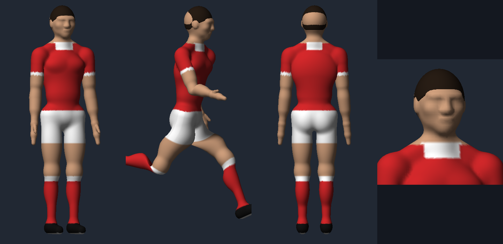

# Matchday

A first-person 11-a-side football game that runs in the browser, built with three.js.
You play as Red River FC's number 9 against Harbour Athletic, with PES-style controls and mechanics.

## Play

Open `index.html` in a desktop browser (Chrome, Edge or Firefox), or serve the folder:

```
npx serve .
```

Click **Kick off**, then click the pitch to lock the mouse. Esc pauses.

## Online play

Online matches use the claude.ai Artifact `room` capability, so they work when the game is opened as a claude.ai
artifact shared with the other players (a standalone copy, such as GitHub Pages, plays single-player only).
One person hosts and runs the match in their browser; others join with the match code and each takes over a player.
Empty slots are played by the computer.

## Features

- First-person view with a natural wide-angle projection, a stabilised head camera and your own body visible when you look down
- Skeletal, animated players with painted faces, kits with names and numbers, a referee and two linesmen
- PES / eFootball controls: gauge passing, through balls, one-twos, finesse, chip and low shots, dynamic first touch, flicks, nutmegs, double touch
- Defending: pressure, containment, standing and sliding tackles, shoulder charges, team press
- Rules: fouls, yellow cards, free kicks with walls, penalties, offside, corners, throw-ins, goal kicks
- Formations, team playstyles, opposition levels and player stats

## Controls

| Key | Action |
| --- | --- |
| WASD / mouse | Move / look |
| Shift | Sprint (twice for a speed burst) |
| Hold click | Shoot (C = finesse, Z = chip, V = low shot) |
| Hold E / Q / R | Pass / lofted pass / through ball |
| Z + E | One-two |
| C | Close control, shield, dynamic first touch |
| V | Double touch, or flick as the ball arrives |
| F / F twice / right-click / B | Press / tackle / slide / shoulder charge |
| C + F | Containment |
| T | Team pressure |
| G | Send a teammate on a run |
| Space | Call for the ball |
| Tab | Shoulder check (quick scan behind you) |
| Esc / M | Pause / mute |

## Player model

`models/matchday_player.glb` is the sculpted, rigged footballer used in the game (glTF 2.0, 16-bone skeleton,
A-pose, kit and face textures). It opens in Blender, three.js or any glTF viewer.

The model is generated from code in `tools/`: `sculpt.py` builds the body from anatomical volumes as a signed
distance field and meshes it with marching cubes, and `build.py` adds hair, kit regions, UVs and skin weights, then
writes the GLB and the compressed copy embedded in the game. Requires Python 3 with numpy, scikit-image and Pillow:

```
cd tools && python3 sculpt.py && python3 build.py
```


